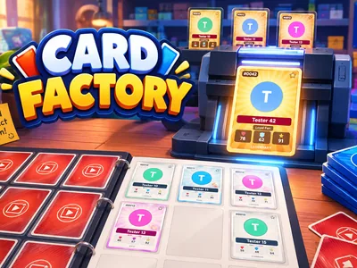
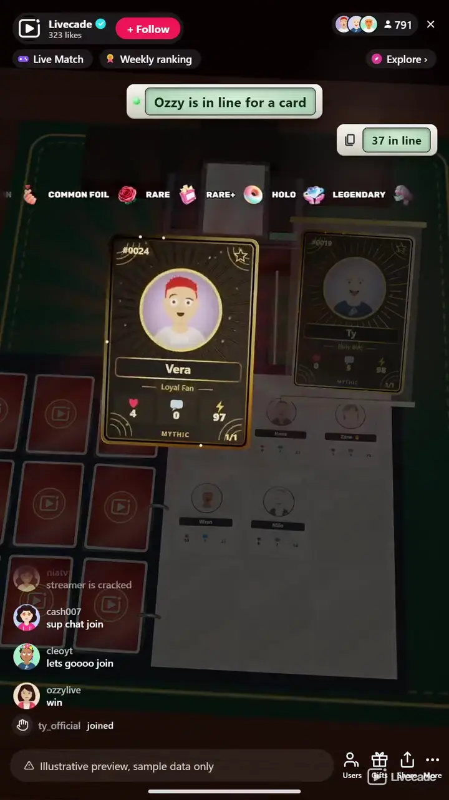

# Card Factory - Interactive TikTok Live Game

> A printer on your stream makes a trading card of each viewer, live.

A card printer on your stream makes a trading card of each viewer live, with their picture, name and stats. A follow or a comment gets a Common card, and gifts skip the line for Foil, Holo, Legendary and Mythic pulls.

**[Play Card Factory on Livecade](https://livecade.io/games/card-factory/?utm_source=github&utm_medium=readme&utm_campaign=card-factory)** - runs as a single browser source in OBS, Streamlabs, or TikTok LIVE Studio. Nothing for viewers to install.

## How viewers play

Viewers take part with the actions TikTok already gives them: **comments**, **follows**, **gifts**, **likes**, **shares**. Every action below is rebindable, so you decide which interaction drives which effect.

| Action | What it does |
| --- | --- |
| **Common card** | A trading card of the viewer. From a follow or comment it joins the free queue, from a gift it skips the line |
| **Common Foil card** | A Common card with a foil corner, ahead of the free queue |
| **Rare card** | A card in a silver frame |
| **Rare+ card** | A silver card with a holo seal |
| **Holo card** | A full holo card with a rainbow sweep |
| **Legendary card** | A gold full art card, revealed from a pack and kept on the showcase shelf |
| **Mythic card** | A black and gold 1/1, the biggest reveal, kept on the showcase shelf |

## How it works

### Follow or comment, get a card

A follow or any comment puts a viewer in the queue, and the printer makes a Common trading card with their picture, name, card number and stats.

### Gifts skip the line

A gift prints ahead of the free queue, from a Rose's Common to a Money Gun's Mythic 1/1, and each rarity has its own reveal.

### A binder of the live

Nine cards fill a binder page, then it turns. A viewer never has two cards on the same page, so one regular cannot fill it.

### Speeds up when busy

A Common card takes about two and a half seconds at normal speed, and the printer gets faster on its own when the line is long. Gift reveals are shortened, never skipped.

## About the game

Card Factory fills your stream with a card shop table in 3D: a graphite card printer, a binder lying open and a shelf of the best pulls. A viewer follows or comments and joins the queue. When their turn comes, a blank card feeds into the printer and comes out as their own trading card: their profile picture, their name, a card number for this live, a type, and stats from what they did on your stream, the likes and comments they sent and a power that rises with the rarity. Then the card flies into its pocket in the binder. Nine cards fill a page, and the page turns when the next card arrives.

### Seven rarities, each with its own reveal

Out of the box a Rose prints a Common card ahead of the free line, a Finger Heart a Common Foil, a Rosa a silver Rare, a Perfume a Rare+ with a holo seal, a Doughnut a full Holo, a Hand Heart a gold Legendary and a Money Gun a black and gold Mythic 1/1. The rarer the card, the bigger the moment: a foil stamp, a lamination sweep, and for Legendary and Mythic a pack that rips open with the card rising into a spotlight. Every gift with a trigger prints, streaks included, so ten Doughnuts are ten Holo cards.

### The latest pull on display

A gift card of Common Foil or better goes to a lit display stand in the middle of the screen after its reveal and stays there until the next one takes its place. Legendary and Mythic cards also join the showcase shelf at the top, so the biggest pulls of the live stay in view.

### Three moments for the host

From the dashboard you can flip through the album, where the binder comes to the front and turns through the pages filled this live, play a showcase close-up of the best pulls one by one, or shuffle the page like a deck. Printing waits while one plays and carries on after.

### Every gift makes a card

A gift with no trigger of its own still makes a card by its value: 1 coin a Common, 5 a Common Foil, 10 a Rare, 20 a Rare+, every 30 a Holo, every 100 a Legendary and every 500 a Mythic, up to 50 cards, 5 Legendaries and 2 Mythics from one send. Turn that setting off and only the gifts you bound make cards.

## What it looks like on stream

[Watch Card Factory gameplay](https://cdn.livecade.io/games/card-factory.mp4)

## What you can configure

- **Language** - Thirteen languages for the cards, the queue and the trigger labels
- **Card collection** - Finished cards go into a binder on the table or onto a wall display
- **Card speed** - Slow, normal or fast. The printer also speeds up by itself when many viewers are waiting
- **Other gifts make cards by their value** - A gift with no trigger of its own still makes a card: 1 coin a Common, 5 a Common Foil, 10 a Rare, 20 a Rare+, every 30 a Holo, every 100 a Legendary, every 500 a Mythic

## Languages

English, Spanish, Portuguese, French, German, Italian, Indonesian, Arabic, Turkish, Russian, Hindi, Romanian, Filipino

## FAQ

<strong>How do viewers get a card in Card Factory?</strong>

Out of the box a follow or any comment puts them in the queue for a Common card. Every trigger can be rebound, so likes, shares or any gift can be the way in instead.

<strong>What is on a viewer's card?</strong>

Their profile picture and name, a card number for this live, a type, and stats: the likes and comments they sent during the live, and a power that rises with the card's rarity.

<strong>What do gifts do?</strong>

A gift prints ahead of everyone waiting for a free card. By default a Rose is a Common, a Finger Heart a Common Foil, a Rosa a Rare, a Perfume a Rare+, a Doughnut a Holo, a Hand Heart a Legendary and a Money Gun a Mythic 1/1. Every gift with a trigger prints, streaks included, and a gift with no trigger of its own makes cards by the coin value of the send.

<strong>Can a viewer get more than one card?</strong>

Yes. A viewer has one free card waiting at a time and never gets two cards on the same binder page, so they can come back on a later page. Gift cards print every time.

<strong>Does it keep up with a big stream?</strong>

A Common card takes about two and a half seconds at normal speed, and the printer speeds up on its own when eight or more cards are waiting. The free line holds up to 200 viewers, while gifts always go to the front.

<strong>Will Card Factory run on my PC?</strong>

It renders in 3D on the computer running your stream, so give it a reasonably modern machine. Try it in the dashboard preview before you go live.

<strong>How do I add Card Factory to my TikTok Live?</strong>

Add one browser source URL to OBS or your streaming software and go live. There is no plugin to install and nothing for your viewers to download.

## Setup

1. [Create a Livecade account](https://app.livecade.io/register?utm_source=github&utm_medium=cta&utm_campaign=card-factory)
2. Copy your overlay browser source URL
3. Paste it into OBS, Streamlabs, or TikTok LIVE Studio
4. Pick Card Factory, set your triggers, and go live

Runs in the browser, so it works on Windows and macOS with nothing to download. [See all TikTok Live games](https://livecade.io/tiktok-live-games/?utm_source=github&utm_medium=readme&utm_campaign=card-factory).

---

_This repository documents Card Factory, a hosted interactive game by [Livecade](https://livecade.io/?utm_source=github&utm_medium=footer&utm_campaign=card-factory). The game runs on Livecade's platform, so there is no source to install here._
